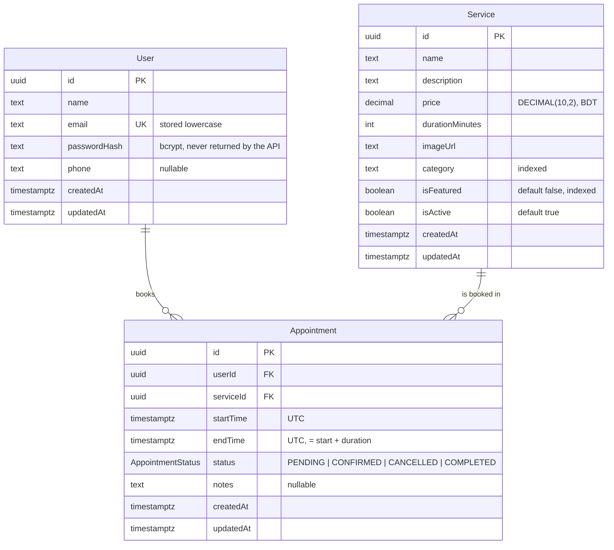

# EasyBook database: ER diagram

PostgreSQL (Neon), managed with Prisma. The source of truth is [`prisma/schema.prisma`](../prisma/schema.prisma) plus the two migrations in [`prisma/migrations/`](../prisma/migrations).



## Relationships

| Relationship | Type | On delete |
|---|---|---|
| User → Appointment | one-to-many (`Appointment.userId`) | **Restrict**: a user with bookings cannot be deleted by accident |
| Service → Appointment | one-to-many (`Appointment.serviceId`) | **Restrict**: retire a service with `isActive = false` instead of deleting it |

## Constraints and indexes

| Name | Table | What it guarantees |
|---|---|---|
| `User_email_key` (unique) | User | One account per email (emails are lowercased before saving) |
| **`appointment_no_overlap`** (exclusion, GiST) | Appointment | One service can never have two non-cancelled bookings whose `[startTime, endTime)` ranges overlap. Hand-written SQL migration using `btree_gist`. |
| `appointment_end_after_start` (check) | Appointment | `endTime > startTime` |
| `Appointment(userId, startTime)` | Appointment | Fast "my bookings" lists, sorted by time |
| `Appointment(serviceId, startTime)` | Appointment | Fast availability and overlap checks |
| `Service(category)`, `Service(isFeatured)` | Service | Fast filtering on the home screen |

The exclusion constraint:

```sql
ALTER TABLE "Appointment"
  ADD CONSTRAINT "appointment_no_overlap"
  EXCLUDE USING gist (
    "serviceId" WITH =,
    tstzrange("startTime", "endTime", '[)') WITH &&
  )
  WHERE (status <> 'CANCELLED');
```

## Setup

```bash
npm run prisma:deploy   # apply both migrations (uses DIRECT_URL)
npm run seed            # 10 services, demo user demo@example.com / Demo1234, 4 sample bookings
```
